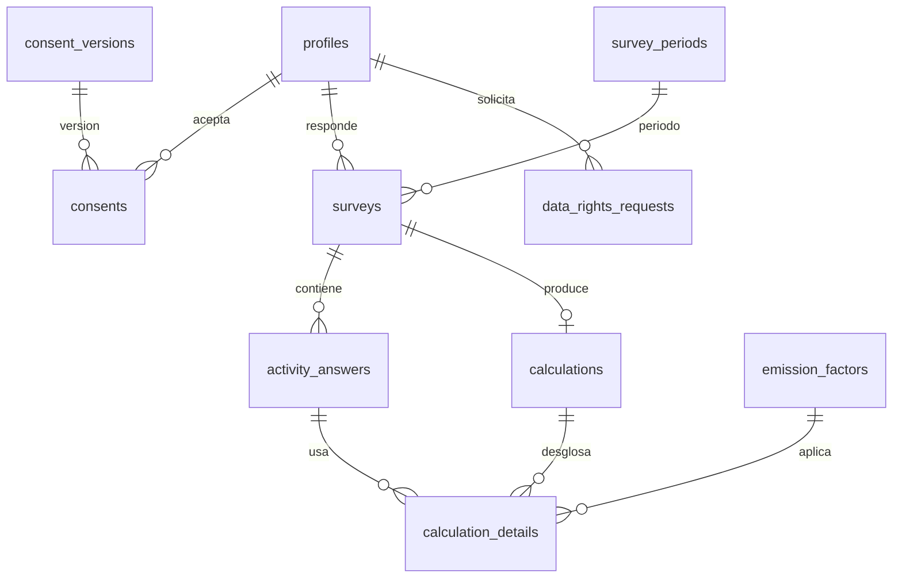

# Datos, seguridad y arquitectura

## ERD

Diccionario: ver comentarios y restricciones en `supabase/migrations/001_esquema_base.sql`.

## Matriz de permisos
| Recurso | Participante | Administrador | No autorizado |
|---|---|---|---|
| Perfil, consentimientos, encuesta, respuestas, informe propios | Leer/escribir (encuesta solo en borrador) | Sin acceso a filas individuales | Ninguno |
| Factores | Leer | Insertar versión nueva (auditado) | Ninguno |
| Periodos | Leer | Gestionar (auditado) | Ninguno |
| Dashboard agregado y CSV | No | Sí, mínimo 10 | No |
| Auditoría | No | Leer | No |
| `admin_roles` | No | No (solo SQL) | No |

## Arquitectura
Navegador (HTML/CSS/JS por módulos) -> Supabase Auth + PostgREST con RLS -> funciones SQL `calcular_huella`, `dashboard_resumen`, `dashboard_muestra`. Despliegue estático (cualquier hosting) y proyecto Supabase.

## Pruebas
`node --test tests/calculo.test.mjs` y `tests/rls_pruebas.sql` (participante, administrador, no autorizado). Registrar aquí el resultado de cada ejecución con fecha.

## Evidencia Scrum (plantilla a completar por el equipo)
Product Backlog = tabla de `01-requisitos-y-trazabilidad.md`. Registrar por sprint: objetivo, Sprint Backlog, incremento, acta breve de Review y retrospectiva, y decisiones con responsable. Sprint 0: alcance y riesgos. Sprint 1: requisitos y UX. Sprint 2: persistencia y cálculo. Sprint 3: dashboard, pruebas y cierre.
